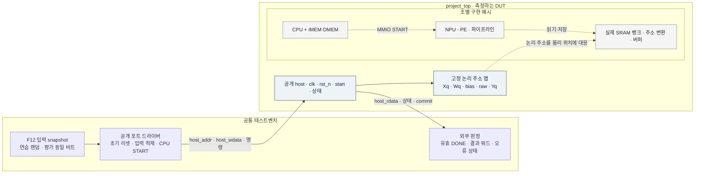

# EE470 F12 블록도와 고정 주소

F12는 같은 공개 입출력 계약을 지키는 서로 다른 SoC 구조를 비교합니다. `project_top` 안에 CPU, IMEM·DMEM SRAM, NPU와 추가 버퍼를 포함합니다. 블록도는 공개 경계와 설계 예시를 구분합니다.



## 고정 논리 주소

다음 주소는 CNN SRAM 창의 **바이트 오프셋**입니다. CPU의 직접 load/store 주소나 SRAM 매크로 핀 주소로 해석하지 않습니다.

| 영역 | 시작 주소 | 배치 |
|---|---:|---|
| Xq | `0x0000` | signed INT8 256개, 워드당 low 8비트 |
| Wq | `0x0400` | signed INT8 36개, 워드당 low 8비트 |
| bias | `0x0490` | signed INT32 4개 |
| raw | `0x0600` | signed INT32 784개 |
| Yq | `0x1240` | signed INT8 784개, 워드당 low 8비트 |

호스트가 Xq[0]에 −7을 적재하는 예입니다.

1. `SRAM_ADDR(0x40C) ← 0x0000`
2. `SRAM_WDATA(0x410) ← 0x000000F9`
3. `SRAM_CMD(0x414) ← WRITE`
4. `SRAM_STATUS(0x418)`의 DONE과 ERR 확인

결과 읽기에서는 `SRAM_ADDR`에 raw 또는 Yq의 지정 오프셋을 쓰고 READ를 요청합니다. 완료 후 `SRAM_RDATA(0x41C)`를 반환합니다. 각 조는 같은 논리 주소를 자신의 물리 뱅크에 대응시키고, 필요하면 내부에서 재배치하거나 패킹합니다. 지정 주소에서 모든 결과가 읽힐 때 DONE을 올립니다.

예를 들어 기준형은 연속 논리 주소를 여러 SRAM 뱅크로 나눕니다. 다른 조는 같은 Xq 주소를 받아 네 8비트 값을 내부 워드 하나에 모으고, 연산기가 로컬 버퍼에서 그 값을 재사용하도록 만들 수 있습니다. 두 설계 모두 양자화 결과를 읽으면 같은 공통 워드 형식을 반환해야 합니다. 면적 리포트에는 각 설계의 실제 SRAM과 주소 변환·버퍼가 포함됩니다.

## 계측 순서

```text
초기 리셋 → 공통 입력·프로그램 적재 → 측정 리셋 해제 ────────────── 유효 DONE → 전체 결과 읽기
                                          t0  CPU START · 내부 이동 · NPU 연산 · 저장  t1
```

- 성능은 `t1 − t0`입니다. 내부 NPU 클록 수를 점수로 사용하지 않습니다.
- 에너지는 같은 `t0–t1` 구간의 DUT 평균 전력과 시간의 곱입니다. 조별 로컬 버퍼 복사·패킹·연산·저장을 포함합니다.
- 면적은 `project_top`에서 합성된 모든 셀과 SRAM 매크로를 합산합니다.
- RTL과 SDF 게이트는 같은 공개 포트를 사용합니다. DONE 뒤 CPU가 결과 주소를 읽고 TB가 각 LW를 공개 commit에서 검증합니다. [F12 공개 LW 검사](F12_COMMIT_READBACK_KO.md)

슬라이드에 옮길 때는 DUT 경계를 한 번 강조하고, 공개 포트와 고정 주소에만 같은 강조색을 사용합니다. 내부 블록은 옅은 무채색과 점선으로 표시합니다. 물리 SRAM 뱅크 개수나 NPU 내부 배선은 별도 기준형 설명에서 구체적으로 그립니다.
